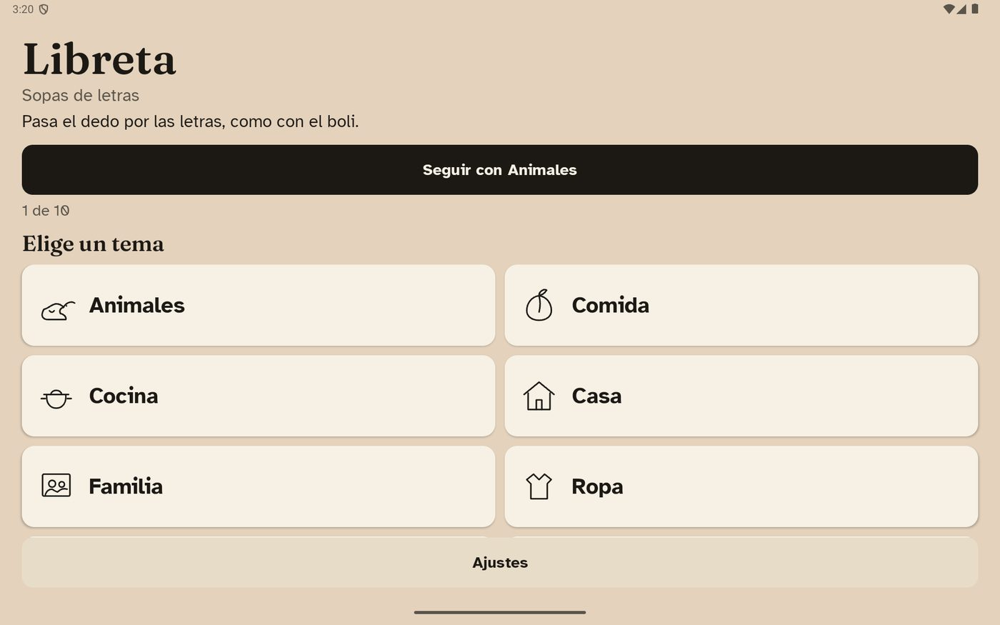
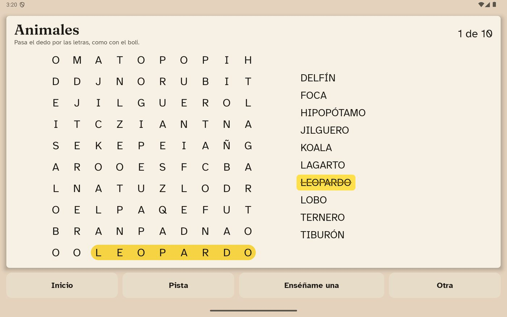

# Libreta

A word search that feels like pen on paper. No ads, no account, no timer.

Android app, Kotlin, for a tablet held in landscape. Spanish puzzles, large type, and a board you play with a finger or a stylus. It does not use the network.

The same rules also exist as a browser build at the repo root (`npm run dev`). The tablet app is `android/`.





## Who it is for

Someone who already finishes paper word searches and should not have to learn a new game. The board is the book: a sheet, a word list, a marker. Around that, almost nothing.

The interface is built for older adults, including people living with Alzheimer's:

- One job on each screen. The unfinished puzzle is a single button, **Seguir**.
- Large type ([Atkinson Hyperlegible](https://www.brailleinstitute.org/freefont/)) and large buttons with words, not icons alone.
- A wrong stroke fades out. There is no buzzer, no red cross, no score, and no clock.
- Drag through the letters, or tap the first letter and then the last. The second path is there because a long drag is hard with a tremor. A finger and a stylus are the same pointer.
- **Pista** circles the first letter of a missing word. **Enséñame una** draws that word in pencil. Neither costs anything.
- Progress stays on the device. Nothing is uploaded.

This is a pastime, not a treatment and not a medical device. There is no good evidence that word searches change the course of dementia, and Libreta does not claim that they do.

## What it leaves out

The big Spanish word-search apps (Blackout's *Sopas de Letras*, Vita Word Search) are the reference for themes, an endless supply of grids, and selecting a word by dragging. They also ship ads, coins, level gates, and a difficulty that climbs on its own. Those are the parts that break a calm session, so they are not in here.

The activity is locked to landscape. There is no pinch-zoom. An accidental pinch, or a turn into portrait, leaves a person outside the sheet with no obvious way back.

## Play

1. Choose a theme. Everyday Spanish: animals, food, the kitchen, the house, family, and so on.
2. Drag through a word in a straight line, or tap its first letter and then its last.
3. The line has to be the whole word. A shorter piece inside a longer one does not count.
4. When the sheet is finished it stays on screen, markers and all. **Otra sopa** deals another of the same theme.

The default is the printed book: all eight directions, a 10×10 grid. In **Ajustes**:

- **Letras muy grandes** — 8×8
- **Letras grandes** — 10×10, the default
- **Más palabras** — 12×12
- **Como en el libro** — all eight directions
- **Solo rectas** — across and down, both ways

Sound is off until it is turned on. There is no account to configure.

## How a sheet is made

`generate` in `android/app/src/main/java/dev/mun0n/libreta/game/Generate.kt` is deterministic. The same seed is the same sheet, which is what **Seguir** restores. The browser copy in `src/game/generate.ts` uses the same mulberry32.

- A seeded shuffle picks words that fit the grid (length 3 to the grid size).
- Words may cross when the letter agrees. A different letter blocks the crossing.
- Empty cells are filled from Spanish letter frequencies. The filler does not invent K or W.
- Accents are removed in the grid (`canción` → `CANCION`). **Ñ stays Ñ.** The list keeps the accents.

Fourteen themes live in `android/app/src/main/java/dev/mun0n/libreta/data/Themes.kt`, each with at least 60 ordinary words. Drag direction locking lives in `Select.kt`.

## Project layout

```
android/app/src/main/java/dev/mun0n/libreta/game/   placement, filler, seed, drag
android/app/src/main/java/dev/mun0n/libreta/ui/     sheet, grid, home, settings
android/app/src/main/java/dev/mun0n/libreta/state/  SharedPreferences, versioned
```

Jetpack Compose. No server. `minSdk` 26, landscape only, aimed at tablets (`requiresSmallestWidthDp` 600, so Play will not offer it on a phone).

## Develop

Open `android/` in Android Studio, or from that directory:

```bash
./gradlew test assembleDebug
```

The debug APK is `android/app/build/outputs/apk/debug/app-debug.apk`.

```bash
adb install -r app/build/outputs/apk/debug/app-debug.apk
```

Tests cover the generator (stable seed, every placed word is readable on its cells, Ñ, words longer than the grid are dropped, a bad crossing is rejected) and the selector (direction lock, exact match, reverse match). The browser build has the same checks: `npm test` at the repo root.

## Install

A tablet, in landscape. Plug it in, install the debug APK, and the icon is Libreta. The sheet is the whole screen. **Ajustes → Letras muy grandes** is the 8×8 board.

The browser build can still be added to an iPad home screen. Those steps are in [docs/ipad.md](docs/ipad.md).

## Privacy

No account, no analytics, no network permission. The current sheet and the count of finished sheets stay in `SharedPreferences` on that device (`libreta.v1`). Fonts are bundled. Atkinson Hyperlegible and Fraunces are SIL Open Font License; the license texts are in `android/third_party/`.

## License

[MIT](LICENSE).
